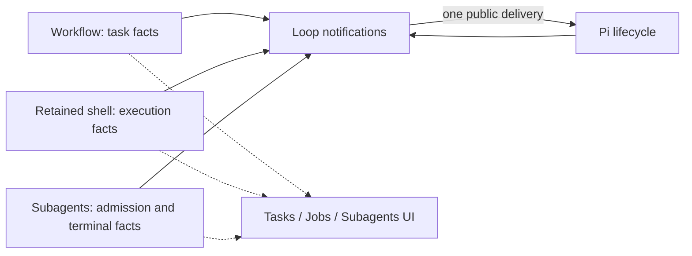

# Loop notifications

`extensions/loop-notifications/` is the only owner of main-model completion wakes for retained shell and managed subagents. Task-list-only automatic continuation is disabled; unfinished tracking does not start a model turn or send a synthetic user message. The three producers publish current facts on Pi's extension event bus. They do not schedule model turns, and they do not import the consumer or each other. Hiding Tasks, Jobs, or Subagents does not change delivery. Disabling this extension disables those automatic notifications; the three tools still execute.

## Contract

Facts use `csheng.loop-notifications.facts.v1`. A snapshot request, `csheng.loop-notifications.snapshot.v1`, lets a late-loaded consumer read current state without polling. A producer that never replies is absent. A loaded producer that replies `unknown` or `unavailable` is not evidence of zero executions; it contributes no deliverable result until it reconciles. `inactive` means that producer will not run executions here, such as print/JSON or another bash owner.

Each execution fact carries its source id, phase (`queued`, `preparing`, `running`, or `terminal`), and a source-owned disposition:

- `pending` may be notified once
- `returning` is already coming back on the foreground tool call and must not also be notified
- `observed` was returned by inspect, wait, join, or another tool result and must not be notified again

Workflow facts carry the current goal and task statuses for observation. Task creation, changes, resume, and interactive/RPC input never create a task-only wake opportunity.

Model-facing guidance leads with the next useful action: assess newly available results, advance independent work, or finish the model turn with execution-dependent tasks unfinished. Inspect serves a specific diagnostic question rather than a completion-wait loop. Task snapshots preserve continuity under the user's current instructions; they add no requirements or authority, and task completion remains an evidence-based judgment. An unfinished task cannot distinguish independent work from a design waiting for user confirmation, so it is not a continuation signal. This is guidance, not an inspect quota or a new runtime gate.

## Decision

The consumer keeps one session-scoped view and one settlement waiter, `csheng-loop-notifications-wait`. It reuses the shared wake reservation so competing completion deliveries do not start two turns for the same opportunity.

| Observed state | Decision |
| --- | --- |
| Terminal already returned or observed | Do not notify it. |
| Terminal ready while the model is active | Keep it pending and project it into the next request. Do not start a competing turn. |
| Terminal ready while idle | Send one combined notice, even if another execution is still running. |
| Pi is settling, compacting, or holding queued input | Revalidate at the next public boundary. No timer and no hidden retry. |
| Settled, no pending terminal notice, regardless of task status or execution inventory | No model wake. |

Consumption happens when the notice is projected into request preparation, or when the source reports the terminal observed. Queuing a send is not acknowledgment. After that projection, the consumer emits `csheng.loop-notifications.ack.v1` so a producer can retire lightweight pending metadata. Shell completion text stays inspectable on the execution owner until acknowledgment, observation, or scope invalidation. Consumed wake copies are still bounded separately; the execution owner does not drop terminal records by count. A send failure records a bounded `csheng.loop-notifications.delivery-error` session entry and does not start a retry loop; the source result stays inspectable through the existing tool. A legitimate new agent run clears the failed-send fence, and a late rejection from an abandoned delivery epoch cannot poison a replacement binding. Interactive or RPC input drops the current undelivered queue. Extension-originated input does not. Abort suppresses the failed attempt's queue; a later `agent_start` clears only that fence.



```mermaid
sequenceDiagram
    participant M as Main model
    participant P as Pi
    participant N as Loop notifications
    participant J as Jobs
    participant S as Subagents
    M->>P: End the turn while a job and a child are running
    P-->>N: Settlement
    Note over N: No terminal result: no wake
    J-->>N: Terminal ready
    N->>P: One completion delivery
    Note over N,S: The sibling still running does not veto it
    P->>M: Resume with that evidence
    S-->>N: Sibling terminal ready
    N->>P: Deliver that evidence
    M->>P: End the turn
    P-->>N: Settlement with todo/doing and no executions
    Note over N,M: No task-only continuation; wait for real input or a new result
```

Print and JSON do not receive these wakes. The consumer does not persist a second copy of execution output; retained shell and subagent records remain the source evidence.
