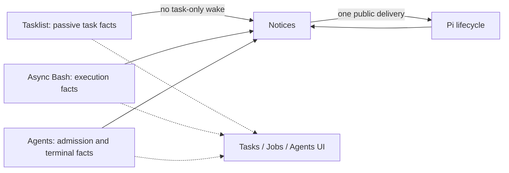

# Notices

`extensions/notices/` is the sole owner of main-model execution notices for Async Bash jobs and Agents. Tasklist is a separate passive producer: task-only notices remain disabled, and its unfinished/blocked/cancelled data neither starts a turn nor blocks execution results. All three producers publish facts independently without importing or scheduling the consumer. Hiding Tasks, Jobs or Agents UI does not change delivery. Disabling Notices disables automatic result delivery, not the execution or data tools.

## Contract

Facts use `notices.facts.v1`. A snapshot request, `notices.snapshot.v1`, lets a late-loaded consumer read current state without polling. A producer that never replies is absent. A loaded producer that replies `unknown` or `unavailable` is not evidence of zero executions; it contributes no deliverable result until it reconciles. `inactive` means that producer will not run executions here, such as print/JSON or another bash owner.

Each execution fact carries its source id, phase (`queued`, `preparing`, `running`, or `terminal`), and a source-owned disposition:

- `pending` may be notified once
- `returning` is already coming back on the foreground tool call and must not also be notified
- `observed` was returned by inspect, wait, join, or another tool result and must not be notified again

A non-terminal execution may carry one `checkpoint` (`id`, `summary`, `disposition`): an attention notice from its producer that the work is still running past a source-owned checkpoint, such as an Async Bash `deadlineSeconds` checkpoint or an Agent inactivity checkpoint. It is delivered once like a result, under its own identity `<execution id>@<checkpoint id>`, and it is not a result: the model decides whether to renew, cancel or keep waiting. Acknowledgments name that identity so the producer can retire it.

Execution facts may also carry the originating native `toolCallId` and Agent `runId`. These opaque references support interaction-scoped observation and explicit adoption of older work; they do not grant control authority.

Tasklist facts carry the list title and item statuses for observation; the `tasklist` producer has no list-control fields. New state, edits, restoration and interactive/RPC input never create a task-only wake opportunity. The producer reports data only; delivery eligibility belongs here.

Model-facing guidance leads with the next useful action: assess newly available results, advance independent work, or finish the model turn with execution-dependent tasks unfinished. Inspect serves a specific diagnostic question rather than a completion-wait loop. Task snapshots preserve continuity under the user's current instructions; they add no requirements or authority, and task completion remains an evidence-based judgment. An unfinished task cannot distinguish independent work from a design waiting for user confirmation, so it is not a continuation signal. This is guidance, not an inspect quota or a new runtime gate.

## Decision

The consumer keeps one session-scoped view and one settlement waiter, `notices-wait`. It reuses the shared wake reservation so competing completion deliveries do not start two turns for the same opportunity.

| Observed state | Decision |
| --- | --- |
| Terminal or checkpoint already returned or observed | Do not notify it. |
| Checkpoint pending for a running execution | Deliver it like a ready terminal, once. |
| Terminal ready while the model is active | Revalidate after foreground tools at `turn_end`; append one native completion message and request continuation. Earlier queued native input, including custom messages, takes precedence. |
| Terminal ready while idle | Send one combined notice, even if another execution is still running. |
| Pi is settling, compacting, or holding queued input | Revalidate at the next public boundary. No timer and no hidden retry. |
| Settled, no pending terminal notice, regardless of task status or execution inventory | No model wake. |

Busy delivery uses Pi's actionable `turn_end` boundary rather than a custom steering queue: foreground inspect/wait/join dispositions are checked after all tools finish, and an existing native queue can observe the result before notice admission. Idle delivery retains the settlement waiter and shared wake reservation. A ready result does not wait for sibling executions to finish, and a naturally required next request satisfies the boundary continuation without an extra model turn.

Each admitted notice is an immutable native `custom_message`. Its version-two details identify the owning session and the producer/execution references; these support deduplication and acknowledgment, not authority or a second execution ledger. Later requests retain the same message at its original transcript position. `context_with_system` only observes preparation: it does not remove old notices, replace their contents or append temporary tails. Native compression and explicit user context edits remain legitimate boundaries.

Consumption happens only when the identified native notice appears in request preparation, not when a send is attempted or a boundary draft is proposed. The consumer then emits `notices.ack.v1` for Async Bash results so that producer can retire lightweight pending metadata. Preparation is not successful provider processing or proof of backend cache reuse. Resume/tree restoration reads branch-local native notice identities to prevent duplicate delivery; it neither wakes the model nor acknowledges unseen content. Compaction can summarize a committed notice before preparation; it does not trigger redelivery or pretend the original notice was observed. Execution evidence remains inspectable at its owner.

Interactive/RPC input suppresses results that have not been handed to Pi; extension-originated input does not. Abort prevents automatic continuation, including when it occurs after a boundary draft was proposed, and suppresses the results still pending at that moment because the user chose to stop. A provider error also ends the request, but the main agent still receives the results: Pi's automatic retry delivers them at its next boundary, and after a final error the idle settlement sends them as one notice, once per result. Once Pi commits the historical completion, cancellation does not delete it: a later explicit user request can see that evidence without a duplicate wake. Source observation after a native handoff likewise does not rewrite history. A synchronous send failure records a bounded `notices.delivery-error` entry and does not start a retry loop; native asynchronous preparation errors remain host-reported because `pi.sendMessage()` exposes no asynchronous delivery receipt. A legitimate new agent run clears the failed-send fence, and a late rejection from an abandoned delivery epoch cannot poison a replacement binding.

## Main-Loop Responsiveness

The parent main loop is the session's UI loop: it should stay free to take user input and deliver results, and long work runs as non-blocking background execution. Async Bash jobs and Agents are the same kind of background execution; Agents add their own lifecycle loop and context isolation. This is a design preference of the harness, carried by mechanisms and by tool text that states how those mechanisms behave; whether to run work in parallel remains the model's and the user's choice.

A tool call that holds the turn delays three things until it returns: steering input, which Pi admits only after the turn's tool calls finish, and Async Bash and Agent results, which busy delivery hands over at `turn_end`. Every foreground observation window therefore yields. `extensions/shared/main-loop-yield.ts` releases an open window when the user submits a steering message in this run, or when this consumer's delivery snapshot holds a ready notice that belongs to other work; input the user queued as a follow-up waits for the run by the user's choice and does not shorten a window. The window owner returns its current running view and the execution continues. Each extension runs its own instance; without this consumer, windows still yield to steering.

Checkpoints are the other half: a long or hung execution surfaces to the model as one checkpoint notice instead of silently holding the session, and it is never killed by default.

## Passive Quiescence Boundary

`extensions/shared/execution-quiescence.ts` combines native idle/queued-message state, producer execution inventory and the consumer's read-only delivery snapshot. For an interaction, quiescence requires the main loop to be idle, no queued main message, all owned queued/preparing/running executions to have ended, and no owned pending or reserved result delivery. The snapshot keeps a reserved delivery visible until request projection resolves the handoff; a terminal event alone is not evidence that the resulting main run has finished. Unknown or unavailable inventory is not a known empty inventory. Tasklist status is irrelevant.

The shared interaction boundary (`extensions/shared/interaction-boundary.ts`) uses this passive boundary to close an autonomous interaction interval across native runs and asynchronous idle gaps; Work Timing and Agent Bark each run their own instance and only read these snapshots. Native tool-call references establish ownership; explicit execution/run receipts can adopt older work, while unrelated existing jobs do not prolong the interval. The observer adds no settlement waiter, timer, prompt or model turn and never becomes a second scheduler.

Any future policy for autonomous continuation **without a new result** must use this same quiescence boundary, plus its separately authorized enablement and continuation policy. Quiescence is necessary, not permission to continue and not proof of business-task completion. That capability remains disabled: this change neither starts a task-only/no-new-result turn nor delays genuine terminal-result delivery until siblings stop. Result delivery still follows the decision table above.



```mermaid
sequenceDiagram
    participant M as Main model
    participant P as Pi
    participant N as Notices
    participant J as Async Bash
    participant S as Agents
    M->>P: End the turn while a job and a child are running
    P-->>N: Settlement
    Note over N: No terminal result: no wake
    J-->>N: Terminal ready
    N->>P: One completion delivery
    Note over N,S: The sibling still running does not veto it
    P->>M: Resume with that evidence
    S-->>N: Sibling terminal ready
    N->>P: Deliver that evidence
    M->>P: End the turn
    P-->>N: Settlement with todo/doing and no executions
    Note over N,M: No task-only continuation; wait for real input or a new result
```

Print and JSON do not receive these wakes. Agent task notices carry phase and result status, available candidate ID and expected episode, changed-path count and a bounded closing report excerpt; paths are not enumerated. The full report remains available through inspect, and execution is not acceptance. Only the bounded completion notice and its references become native conversational history; Async Bash and Agent records remain the source execution evidence. There is no separate persisted notification queue. Private event/storage names are retained rather than migrating live histories. The inline Mermaid diagrams above are the product-owned diagram sources.
