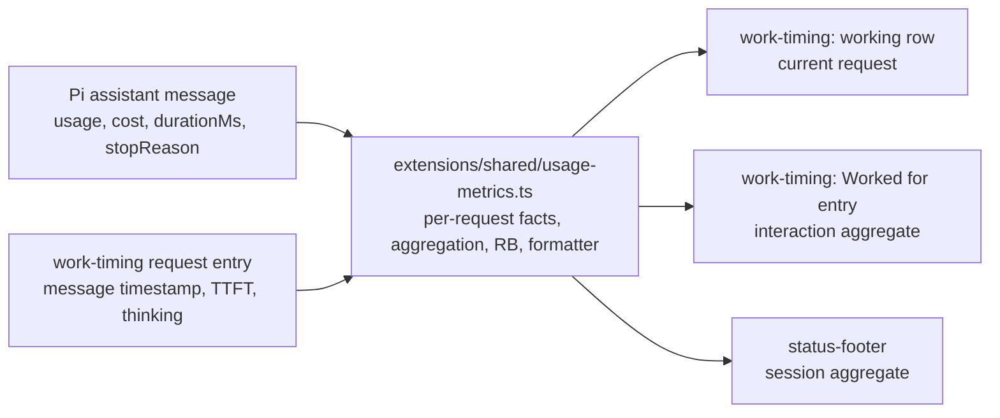

# Usage metrics

The working row is the request lane, `Worked for` is the interaction lane, and the footer is the session lane. Each lane uses the same definitions for its scope.

## Durable Design Intent

These user preferences and their rationale govern the three surfaces.

- I-1 Scope by location, not by marker. The lane determines scope. Do not add per-field markers such as `x̄` or `Σ` to distinguish scopes inside one lane; a lane shows one scope only.
- I-2 One update moment per metric category across lanes. A settled metric appears or changes when its underlying fact is settled, and every live lane showing that category changes at that moment. A footer metric that changes mid-request, or a lane that updates on a different event than another for the same category, is a defect. Two exceptions are deliberate: the working row may show in-flight estimates that settlement replaces, and the `Worked for` entry is a one-time summary written when the interaction ends.
- I-3 Industry definitions. Latency and throughput follow OpenRouter's documented definitions and are cross-checked against Artificial Analysis. Labels follow common industry display: `TTFT` and `tok/s`.
- I-4 Averages, not latest values, outside the request lane. Interaction and session lanes aggregate. The request lane is the only place for a single request's value.
- I-5 `RB` is identical everywhere: count, re-billed tokens and extra dollars, absent when there is none. It reproduces Pi's `/session` "Cache Re-billed" calculation so that users can cross-check it.
- I-6 Compact display. Prefer a recognizable single-cell glyph over a word when one exists; avoid emoji and East-Asian-ambiguous-width glyphs, which render two cells in some terminals.
- I-7 Forward-only. New code does not carry compatibility branches for older persisted formats. Historical entries may render incompletely or with older semantics; only new sessions need accurate values.
- I-8 Purpose over decoration. A field earns its place by supporting cache/cost attribution or provider speed comparison.

## Field Matrix

All three lanes use one formatter and this field order: `↑ ↓ R W CH $ RB`, then `✻`, `TTFT`, `tok/s`.

| Field | Request lane (working row) | Interaction lane (`Worked for`) | Session lane (footer) |
| --- | --- | --- | --- |
| `↑` | Uncached input (`usage.input`) of the request | Sum | Sum |
| `↓` | Output of the request; a character estimate while streaming | Sum | Sum |
| `R` / `W` | Cache read / write of the request | Sum | Sum |
| `CH` | Request hit rate: `cacheRead / (input + cacheRead + cacheWrite)` | Prompt-token-weighted mean over the interaction's requests | Same over the session |
| `$` | Request cost | Sum | Sum |
| `RB` | The request's re-bill, when Pi's rule counts one | Count, tokens, dollars | Count, tokens, dollars |
| `✻` | Thinking duration of the request | Sum, with share of work elapsed | Sum |
| `TTFT` | Request TTFT | Arithmetic mean over requests | Arithmetic mean over requests |
| `tok/s` | Request throughput | `Σ output / Σ request duration` | Same over the session |

- `RB` renders as `RB<count> <tokens>` followed by ` $<amount>` with three decimals; the amount is omitted below $0.0001 (subscriptions, unknown prices). In the request lane the count is 1.
- A usage field is omitted when its value is zero; `CH` appears whenever the lane has assistant prompt tokens, so a request with no cache read shows `CH0.0%`, and `RB` is absent when nothing was re-billed.
- `✻` replaced the working row's former `R` / `ΣR` thinking label, which collided with the cache-read `R` once both appear in one row. `✻` (U+273B) has neutral East Asian width and is the thinking indicator used by Claude Code. `∴` was rejected as ambiguous-width; emoji were rejected as double-width.
- The footer's `CH` is the session mean and carries no `x̄` marker; the latest request's hit rate is shown only in the working row.
- Entry population. The session lane uses every entry of the session file (`sessionManager.getEntries()`), the population Pi's `/session` uses, so tree navigation does not change it. The interaction lane uses the usage-bearing entries that settle during the interaction, counted from the external input that opened it, so a compaction Pi runs between that input and the run start belongs to it; a promoted run's interaction counts from the promoting input. The request lane uses one assistant message.
- Usage sums (`↑ ↓ R W $`) count assistant messages, tool results that carry usage, and compaction and branch-summary entries. `CH` counts assistant messages only. `RB` follows Pi's scan: assistant messages are the requests, compaction and branch summaries reset the baseline, and a Pi `cache_warm` entry refreshes it without being counted.
- Speed eligibility. `tok/s` counts an assistant message whose stop reason is neither error nor aborted, whose output is positive, and whose `durationMs` is positive. `TTFT` and `✻` additionally need a matched timing entry; `TTFT` also needs an observed first output signal. An ineligible or unmatched request contributes to the usage fields only, and a lane with no eligible request omits the field.
- Only the main session's requests are counted; managed child sessions keep their own records.

Illustrative rows:

```text
Working... 1m12s • TTFT 3.2s…
Working... 1m15s • ↓420 • ✻ 6s • TTFT 3.2s • 21 tok/s
Working... 1m20s • ⚙ 5s • ↑75k ↓241 CH0.0% $0.759 RB1 62k $0.560 • ✻ 1s • TTFT 9.8s • 18 tok/s
Worked for 6m55s • ↑204k ↓10k R1.1M CH83.8% $3.591 RB14 90k $0.813 • ✻ 19s (5%) • TTFT 8.1s • 25 tok/s
GPT-6 high | ~/proj | <uuid> | ↑204k ↓10k R1.1M CH83.8% $3.591 RB14 90k $0.813 | ✻ 2m10s TTFT 8.1s 25 tok/s | 111k/272k (40.6%) | MCP 2/2
```

## Metric Definitions

- Request duration is Pi's `durationMs` on the assistant message: a monotonic clock from stream creation, just before the provider request is sent, to the end of the response.
- `tok/s` per request is `usage.output / (durationMs / 1000)`, the OpenRouter per-request formula `output tokens / (TTFT + streaming time)`. Output includes reasoning tokens, as in both references. Aggregates are `Σ output / (Σ durationMs / 1000)` over eligible requests, a ratio of sums: this is Artificial Analysis's multi-turn session definition and avoids the low bias that very short tool-call requests give a per-request median.
- `TTFT` is the first observed output signal (thinking start, or the first thinking, text or tool-call delta) minus the request start. The final value anchors the request start at `message_end time − durationMs`, so `TTFT` and `tok/s` share one start point. While waiting, the live counter starts at the main agent's `before_provider_request`.
- A transport that never fires `before_provider_request`, such as an extension provider's custom `streamSimple`, shows neither the live `TTFT…` counter nor live `tok/s`; its first assistant stream event marks the request start for the working row, and its settled `TTFT` and `tok/s` still come from `durationMs`.
- A provider that does not stream reasoning delays the first observed signal, so its `TTFT` includes hidden reasoning time. This is a client-side limit and is documented, not corrected.
- `RB` per request is Pi's rule: the miss is `min(previous prompt, current prompt) − cacheRead`. It counts only above 1024 tokens, after the first request since a reset and once cache activity has been seen. Dollars are the miss times the request's paid rate minus its cache-read rate, with the model-registry cache-read price when the request read nothing. Compaction and branch summaries reset the baseline.
- `RB` is always attributed against the session's preceding history, never against a lane-local slice. The shared scan walks the session entries up to each request and yields one per-request re-bill fact; a lane selects and sums the facts of its requests. The first request of an interaction therefore carries the same re-bill it carries in the session lane.

References for the documented definitions:

- OpenRouter, Latency and Performance: <https://openrouter.ai/docs/guides/best-practices/latency-and-performance>
- Artificial Analysis, Performance Benchmarking Methodology: <https://artificialanalysis.ai/methodology/performance-benchmarking>

## Update Cadence

| Category | Fields | Moment | Lanes |
| --- | --- | --- | --- |
| Settled request metrics | `↑ ↓ R W CH $ RB ✻ TTFT tok/s` | When Pi persists the request's assistant message; for the footer, also when a usage-bearing tool result, compaction or branch-summary entry is appended | Working row switches to that request's final values; the footer recomputes the session from persisted entries |
| In-flight estimates | Live `TTFT…` counter, live `✻`, estimated `↓`, live `tok/s` | Stream events and the one-second clock | Working row only; replaced by settled values at settlement |
| Wall clocks | `Working…` elapsed, `⚙` tool timer | One-second clock | Working row only |
| Interaction summary | All fields of the interaction lane | Once, when the interaction ends | `Worked for` entry; never changes afterwards |
| Current state | Model, thinking level, ⚡, subscription, branch, MCP, context fill | Their own events; context fill follows Pi's `getContextUsage()`, which also estimates messages appended after the last response | Footer; these describe the present, not settled measurements |

The working row keeps the last settled request's values while tools run and until the next request starts: the main agent's `before_provider_request`, or the first assistant stream event on transports without that stage. `turn_start` alone does not clear them, because Pi may still process queued messages and prepare the request after it.

The footer achieves this cadence by construction: its metric fields are a pure function of persisted entries, and a request enters the aggregate only through its persisted assistant message. A timing entry whose assistant message is not yet persisted contributes nothing, so a render between the two appends shows the previous settled state. A request in flight therefore never moves a footer metric.

The compact duration format joins units without spaces, for example `1m12s`.

## Data Sources And Ownership



- Pi's assistant message already persists usage, cost, `durationMs` and stop reason. Every lane computes `↑ ↓ R W CH $ tok/s` from it, and `RB` from the shared session-history scan described above.
- Pi persists no first-token time or thinking duration. `work-timing` appends one context-free custom entry per main-session request carrying the assistant message's `timestamp` as the join key, `TTFT` when a first output signal was observed, and thinking duration. It appends the entry during its `message_end` handler, before Pi persists the message, so the timing fact already exists when the assistant message settles. Joining by message timestamp follows the existing per-message `compact-thinking-duration` pattern.
- The join is one-to-one. The main loop has one request in flight at a time, so its assistant timestamps are unique within a session; if two timing entries or two assistant messages share a timestamp, those requests are treated as unmatched. The request lane applies the same join to the session entries plus the not-yet-persisted message, so a duplicated timestamp leaves the working row without timing exactly as it does the other lanes. If a later extension's `message_end` handler replaces the message with a different timestamp, the request is unmatched and only its timing fields are omitted.
- Appending during `message_end` is a precondition, not an optimization. This ordering was verified against installed Pi 1.5.0. A later append would let timing settle after usage and break I-2, so if the host rejects it the change returns to design rather than falling back silently.
- The context-free `work-timing-request` entry is version 1 and stores `messageTimestamp`, optional `ttftMs`, and `thinkingMs`. The context-free `work-timing` completion entry is version 5 and stores `totalMs`, `humanWaitMs`, `scope`, `status`, and the interaction aggregate in `metrics`; it renders without rescanning the session.
- A request belongs to the interaction in which it settles. When human input promotes an automatic run mid-request, the in-flight request counts wholly toward the new interaction: usage, cost, `RB` and `TTFT` are whole-request facts from the provider and Pi, and a partial share would be an estimate. This replaces the earlier post-cut output estimate for metrics; the interaction's work-elapsed clock keeps its existing cut at the input moment.
- One shared module under `extensions/shared/` owns per-request fact extraction, the re-bill scan, aggregation and the metric-block formatter. `status-footer` and `work-timing` each run it on their own inputs, consistent with the package rule that extensions share algorithms, not state.
- `status-footer` reads `work-timing` request entries read-only. Without them it omits `✻` and `TTFT` and shows every other field. `work-timing` does not depend on the footer.
- No model-visible context, prompt, tool declaration or provider payload changes. The new entries are custom entries, which Pi excludes from model context, so prompt-cache behavior is unaffected.

## Cutover

The cutover is forward-only; there is no compatibility normalization for older entries. New sessions get accurate values; older sessions render whatever their stored fields support. No setting toggles old and new behavior. Recovery is reverting the product commit.

## Boundaries And Non-Goals

- `work-timing` gains one responsibility: the per-request timing entry. It still owns the working row and the completion entry, and it judges neither completion nor billing.
- `status-footer` still persists nothing and still owns only the footer.
- `agents-ui` per-agent rows keep their current latest-prompt `CH`. Applying the lane model to that observer is a separate follow-up decision.
- The footer's dollar total still excludes Pi `cache_warm` usage and `cache-keepalive` refreshes; including them is a separate decision.
- No provider-side metrics, percentiles, or exclusion of short completions are added.

